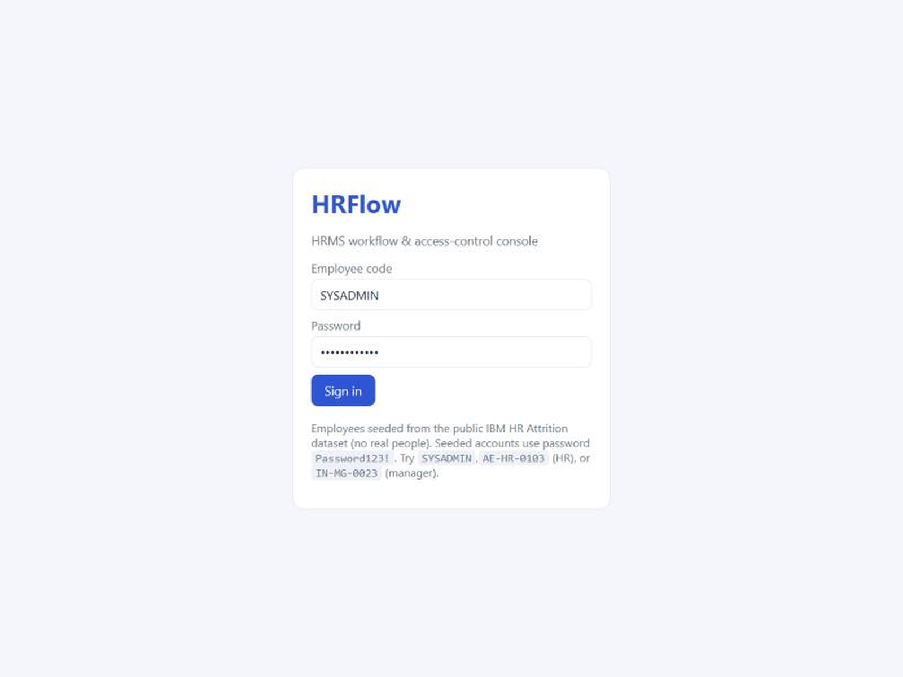
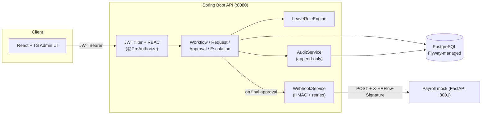
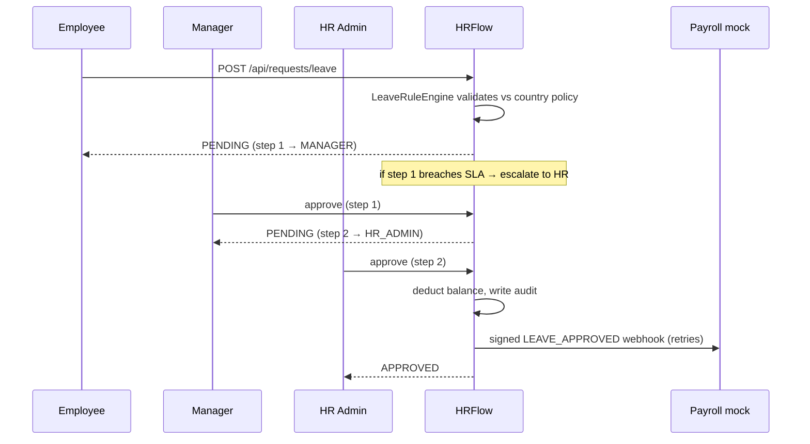

# HRFlow

**An HRMS workflow, access-control and integration engine** — configurable
multi-level approval workflows, role-based access control, an append-only audit
trail, country-specific leave rules, bulk employee import, and a signed payroll
webhook integration. Built to mirror the core of a Darwinbox-style HRMS.

> ℹ️ **Employees are seeded from a real public dataset; no real individual's
> data is used.** The startup seed loads the
> [IBM HR Analytics Employee Attrition dataset](https://www.kaggle.com/datasets/pavansubhasht/ibm-hr-analytics-attrition-dataset)
> (`WA_Fn-UseC_-HR-Employee-Attrition.csv`, 1,470 rows; Kaggle slug
> `pavansubhasht/ibm-hr-analytics-attrition-dataset`, licensed **DbCL-1.0**). It
> is a fully anonymised teaching dataset published by IBM data scientists and
> contains **no real people** — it ships with no names, so each account shows a
> neutral `Employee NNNN` label derived from its real `EmployeeNumber`.
>
> - **Real (verbatim from the dataset):** Department, JobRole, JobLevel,
>   MonthlyIncome, Age, Gender, MaritalStatus, and the EmployeeNumber behind each
>   `employee_code` and display label.
> - **Operational (assigned by the app, not personal data):** login emails on the
>   reserved, clearly-non-real `.invalid` domain; the shared demo password
>   `Password123!`; the HRFlow access role (derived from the real JobRole/Department);
>   the leave-rule country (round-robined across IN/UAE/DE only to exercise the
>   multi-jurisdiction engine — the dataset has no geography); and the
>   manager / HR-business-partner wiring (the dataset has no org chart).
> - **App-generated at runtime (operational, not sourced data):** every approval,
>   escalation, audit-log and webhook-delivery record is produced by the engine as
>   you drive it.
>
> The country leave numbers in `V2__seed_reference_data.sql` remain simplified
> illustrative approximations — not legal advice.

## Demo



*The React + TypeScript admin console (Vite dev server). Sign in with a seeded
account (all use the demo password `Password123!`) to reach the requests,
approvals, workflow-config and audit-log views; the SPA proxies `/api` to the
Spring Boot backend. Example seeded logins: `SYSADMIN` (system admin),
`AE-HR-0103` (HR admin), `IN-MG-0023` (manager) — codes are
`<country>-<kind>-<real EmployeeNumber>`.*

## Stack

| Layer        | Technology |
|--------------|------------|
| Backend      | Java 17, Spring Boot 3.5 (Web, Data JPA, Security, Validation, Actuator) |
| Database     | PostgreSQL (16 in Docker; a real embedded Postgres for tests), Flyway migrations |
| Auth         | Spring Security + JWT (HS256, `jjwt`) |
| Integration  | Mock payroll service in Python (FastAPI), HMAC-SHA256 signed webhooks |
| Frontend     | React + TypeScript (Vite) |
| CI           | GitHub Actions (build + test Java, Python and TypeScript) |

## Module map

```
hrflow/
├── backend/        Spring Boot API (the engine)
│   └── src/main/java/com/hrflow/
│       ├── domain/    JPA entities + enums
│       ├── repo/      Spring Data repositories
│       ├── security/  JWT service, auth filter, principal
│       ├── rules/     LeaveRuleEngine (pure country-rule logic)
│       ├── service/   Workflow, Request, Approval, Escalation, Audit, Import, Webhook
│       ├── web/       REST controllers + error handling
│       └── seed/      seeds employees from the real IBM HR Attrition dataset
├── payroll-mock/   FastAPI webhook receiver (HMAC verify + failure injection)
├── ui/             React + TypeScript admin console (Vite)
├── sample-data/    import-demo CSVs (real-derived sample + a validation fixture)
│                   and IBM-dataset provenance (ibm-hr-attrition/SOURCE.md)
└── docker-compose.yml  full stack (documented reference artifact)
```

## Architecture



### Leave approval flow (the seeded two-step chain)



## Running

### Tests (no Docker, no local Postgres required)

```bash
# Backend — uses a real embedded Postgres (zonky), auto-downloaded.
cd backend && ./mvnw test

# Payroll mock
cd payroll-mock && python -m venv .venv && . .venv/Scripts/activate \
  && pip install -r requirements.txt && pytest -q

# UI (type-check + bundle)
cd ui && npm install && npm run build
```

### Local dev

```bash
# 1. Backend (needs a Postgres; see docker-compose or point HRFLOW_DB_* at your own)
cd backend && ./mvnw spring-boot:run     # :8080, set HRFLOW_SEED=true to seed 1,470 IBM-dataset employees

# 2. Payroll mock
cd payroll-mock && uvicorn app:app --port 8001

# 3. UI
cd ui && npm run dev                      # :5173, proxies /api to :8080
```

### Whole stack (on any host with Docker)

```bash
docker compose up --build   # db + api + payroll-mock + ui
```

## API

| Method | Path | Role | Purpose |
|--------|------|------|---------|
| POST | `/api/auth/login` | public | Exchange employee code + password for a JWT |
| POST | `/api/requests/leave` | any | Raise a leave request (country-rule validated) |
| POST | `/api/requests` | any | Raise an onboarding/expense request |
| GET  | `/api/requests/mine` | any | My requests |
| GET  | `/api/requests/{id}` | owner/admin | View a request |
| GET  | `/api/approvals/inbox` | approver | Requests awaiting my decision |
| POST | `/api/approvals/{id}/decision` | eligible approver | Approve / reject current step |
| GET  | `/api/approvals/{id}/history` | any | Decision history |
| GET  | `/api/admin/workflows` | HR/SYS admin | List workflow definitions |
| GET  | `/api/admin/workflows/{id}` | HR/SYS admin | Get one workflow |
| POST | `/api/admin/workflows` | HR/SYS admin | Create a workflow (deactivates prior active) |
| PUT  | `/api/admin/workflows/{id}` | HR/SYS admin | Edit a workflow |
| POST | `/api/admin/employees/import` | HR/SYS admin | Bulk CSV import |
| GET  | `/api/admin/imports/{batchId}/errors` | HR/SYS admin | Row-level import errors |
| GET  | `/api/admin/audit` | HR/SYS admin | Paginated, filterable audit log |
| POST | `/api/admin/escalations/run` | HR/SYS admin | Run the SLA escalation sweep |

Plus `GET /actuator/health`.

## Metrics (from real runs)

See [`metrics.json`](metrics.json). Highlights:

- **31 automated tests** (27 Java incl. embedded-Postgres integration + 4 Python); 29 run in CI, 2 are live webhook tests needing the running mock.
- **16 REST endpoints** across 3 roles, with service-layer RBAC.
- **3 workflow types** (LEAVE, ONBOARDING, EXPENSE), stored as editable data.
- **9 leave policies + 12 public holidays** seeded across India, UAE, Germany.
- **1,470 real employees** seeded from the IBM HR Attrition dataset (plus 1
  operational system-admin) — 102 managers and 52 HR admins derived from the
  dataset's own JobRole/Department, wired into a manager hierarchy.
- **Dirty-CSV import**: 8 rows → 3 imported, 5 rejected with reasons (no silent drops); idempotent on re-import.
- **Webhook delivery**: succeeds on the 3rd attempt after 2 injected failures; marked FAILED after exhausting 3 attempts — proven against the live mock.

## Notes & trade-offs

- Tests run on embedded PostgreSQL 14 (zonky); production/compose uses Postgres 16. The SQL used (JSONB, partial unique index, `timestamptz`) is compatible with both.
- The payroll webhook is delivered synchronously inside the approval transaction for simplicity and real metrics; production would use a transactional outbox (the schema + `WebhookService.redeliver` already support async delivery).
- Weekend is treated as Sat/Sun for all countries; genuine country differences are expressed via policies and holiday calendars.

## Author

Built by [immortalxmachine](https://github.com/immortalxmachine).
